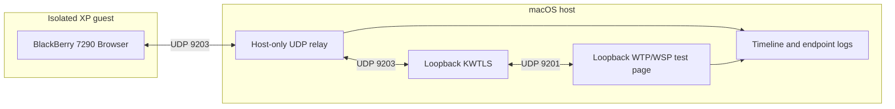

# Windows XP test lab

[Handbook](../README.md) · [Tooling](TOOLS.md) · [Testing](TESTING.md)

Use this guest for live interoperability testing with software from the WAP era. The Rust tests and saved captures can run on the host.

## Start with an isolated clone

1. Reuse a working XP clone if you have one. For a fresh guest on Apple Silicon, use UTM's QEMU x86 emulation and your own Windows XP installation media. Start with UTM's classic Windows guidance for an XP-compatible machine profile.
2. Give the guest one host-only NIC with an XP driver. The verified lab used guest address `192.168.128.2/24` and host bridge `192.168.128.1`. Leave the guest's default gateway and DNS blank. Confirm the guest sees the NIC and the expected address with `ipconfig /all`.
3. Stage installers on read-only media. Note the source, build, and checksum before opening an installer. Keep the base guest available as a clean starting point for a new clone.

[UTM classic Windows setup](https://docs.getutm.app/guides/classic-windows/) · [QEMU host-only networking](https://docs.getutm.app/settings-qemu/devices/network/network/) · [Verified lab settings](../KWTLS_LAB_BASELINE.md#build-and-launch)

## Know where each piece runs



| Path | Address in the verified KWTLS setup |
| --- | --- |
| Guest to relay | Host bridge `192.168.128.1:9203`. The relay accepts the lab guest's IP. |
| Relay to gateway | Host loopback `127.0.0.1:9203`. |
| Gateway to WAP test page | Host loopback `127.0.0.1:9201`. |
| Public lab root enrollment | Host bridge UDP `9201` during enrollment. The response carries the native WTLS CA certificate. |

Some earlier Rust-gateway runs used QEMU's loopback alias `10.0.2.2`. Use that address only with the corresponding guest network. For host-only operation use the configured bridge and the appropriate relay. [Rust-gateway setup](../REFERENCE.md#reusable-udp-adapter-and-blackberry-lab)

## Open the stock BlackBerry Browser

1. Install the verified **RIM JDE 4.0** package and run `7290.bat` from its simulator directory. The stock simulator used UDP source port `8205` in the recorded setup.
2. Choose the gateway lane in [Testing](TESTING.md#live-blackberry-and-kwtls). For the KWTLS lane, build the pinned historical gateway on the host using the [build recipe](../KWTLS_LAB_BASELINE.md#build-and-launch).
3. Use a matching lab CA and leaf. For a fresh clone, generate a local identity, enroll the public root through the Browser, check its fingerprint and **Explicitly Trusted** status, and confirm **Prompt For Server Trust** is enabled. Keep the private identity local. The [enrollment notes](../../fixtures/HISTORICAL_PEERS.md#blackberry-native-ca-enrollment) show the stock Browser flow and the expected clear offer.
4. In Browser **Go To**, enter the lab URL below. In UTM, XP Notepad and the simulator's **Edit → Paste** preserve the semicolon-separated gateway settings.

```text
http://kwtls.lab.invalid/baseline;WAPGatewayIP=192.168.128.1;WAPGatewayAPN=rim.net.gprs;WAPGatewayPort=9203
```

For WinWAP, use its **Secure Connection less** mode and the separate UDP `9202` lane. [WinWAP run and command](../REFERENCE.md#direct-winwap-compatibility-test)

## Finish a run

Save the capture and matching endpoint receipt, then stop the relay and gateway. Shut Windows down through the guest and confirm UTM reports the VM as stopped. On the host, check for leftover listeners on the test ports.

```sh
lsof -nP -iUDP:9201 -iUDP:9202 -iUDP:9203
```

A clean shutdown leaves no lab listener in the output. A lab URL saved inside XP can be reused after restart. The committed [fixtures](../../fixtures/) are the durable evidence.
